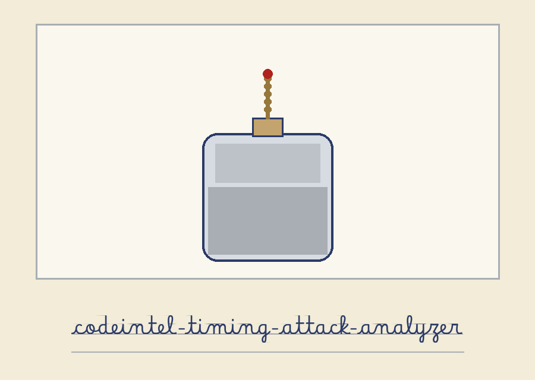

# codeintel-Timing-Attack-Analyzer

Title block: the name above is set in Betania Patmos In GDL in star chart indigo on a paper plate in specimen label style, with a ruled line below and a small jar at the left, beside this first heading only. Headings after this stay typographic.

Instruments each function in a Python file with timing prints, runs the instrumented file a chosen number of times, and collects the printed timings in an output file. It computes no vulnerability verdict and no correlation with secret data; the threshold option is validated but not applied to the results. - Focused on Tools for static code analysis, vulnerability scanning, and code quality assurance

## Install

> **Bench note: flagged install line.** The clone line above uses the unhyphenated name ShadowGuardAI. The correct organisation is ShadowGuard-AI. The line stands as printed and is counted in the fault tally for this repo.
`git clone https://github.com/ShadowGuardAI/codeintel-timing-attack-analyzer`

## Usage

> **Bench note: placeholder usage line.** The line above is a placeholder and not an accepted invocation. The parser accepts: python3 main.py TARGET_FILE [--iterations N] [--threshold T] [--output FILE] [--dependency_check]. That line is taken from main.py.
`./codeintel-timing-attack-analyzer [params]`

## Parameters

> **Bench note: the missing positional.** The list above omits target_file, which is required and positional and gives the Python file to analyse. The restoration lives on the website only and is marked restored there.

> **Bench note: Threshold Is Checked, Not Applied.** The threshold is validated and must lie from 0 to 1 inclusive, with a default of 0.05; iterations default to 100, the output defaults to timing_analysis.log, and the dependency check tests bandit, flake8, pylint, and pyre-check, none of which the timing run uses.
- `-h`: Show help message and exit
- `--iterations`: No description provided
- `--threshold`: No description provided
- `--output`: No description provided
- `--dependency_check`: No description provided

## Exit code
The number of failed iterations is logged on every run. If any iteration's instrumented run exits non-zero, the analysis exits 1 instead of reporting completion. A working target that runs cleanly on every iteration still completes at exit 0 with its results in the output file.

> **Bench note: flagged licence line.** The line below carries the same unhyphenated name as the install line. The LICENSE file in the repository carries the MIT License. Both facts stand and are not reconciled silently.

## License
Copyright (c) ShadowGuardAI
